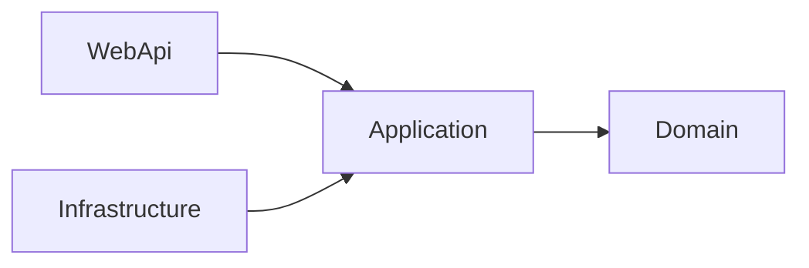

# CinemAPI — guía para la defensa

Sistema de gestión de un complejo de cines: una API REST en .NET 10 (`CinemAPI`) y un front web en React 19 + Vite (`CinemAPIFront/cine-frontend`). Este documento resume qué hace, cómo está armado, por qué se tomó cada decisión y cómo mostrarlo en vivo.

## 1. Qué hace, por rol

| Rol | Qué puede hacer |
|---|---|
| Visitante (sin sesión) | Ver la cartelera, filtrar por día y género, ver la ficha de cada película con sus horarios y butacas libres. Al tocar "Comprar" se le pide ingresar y vuelve a la película |
| Cliente | Comprar entradas eligiendo butacas en el mapa (máximo 10 por compra), ver el resumen con el cargo por servicio, ver "Mis entradas" y cancelar hasta 2 h antes de la función, editar su perfil |
| Admin | Catálogo (películas, géneros, salas con filas × butacas, funciones), Ventas (filtros y cancelación de cualquier compra), Reportes (ventas y ocupación), Clientes (búsqueda, baja y reactivación) |
| SuperAdmin | Todo lo de Admin + Administradores (alta con contraseña inicial, edición, baja, reactivación) + Cargos (ABM y cuál está vigente) |

## 2. Arquitectura

### Backend: Clean Architecture

- **Domain**: entidades, interfaces de repositorio y excepciones de dominio. No conoce EF ni ASP.NET.
- **Application**: un servicio por caso de uso (`PurchaseService`, `ReportService`, …), DTOs y mapeo manual. Solo conoce Domain.
- **Infrastructure**: `CinemAPIContext` (EF Core 10 + SQL Server), repositorios, migraciones y seeders.
- **WebApi**: controllers delgados, JWT y políticas, y un `IExceptionHandler` global que traduce las excepciones de dominio a ProblemDetails.

La regla de dependencias la verifica un test (`LayerDependencyTests`), no solo la convención.

**Por qué servicios + repositorios y no MediatR/CQRS:** el alcance de la materia no lo justifica; con las herramientas de .NET (DataAnnotations, `IExceptionHandler`, `ProblemDetails`) alcanza y el código se lee de una pasada.

### Frontend

- `src/api/`: la única capa que habla con el backend (`request()` agrega el token, traduce ProblemDetails a mensajes y avisa el 401).
- Componentes genéricos (`EntityForm`, `EntityCard`, `EntityGrid`) + `useEntityCrud`: todos los ABM (géneros, salas, cargos, clientes, administradores) son configuraciones de campos, no copias de componentes. Fue el pedido principal del feedback del profesor.
- Dos layouts: `PublicLayout` (barra superior, cartelera y área del cliente, se colapsa en celular) y `AppLayout` (barra lateral del staff).
- Las pantallas que no son públicas se cargan con `React.lazy`: la cartelera abre con un JS de ~300 kB.

## 3. Decisiones importantes (y por qué)

1. **La carrera por una butaca la decide la base.** El servicio valida que la butaca esté libre (para dar un mensaje claro), pero dos compras simultáneas pueden pasar esa validación. Un índice único filtrado `(ShowtimeId, SeatRow, SeatNumber) WHERE IsCancelled = 0` hace que la segunda falle; el contexto traduce el error 2601 a una excepción de dominio y el cliente recibe 409 "Alguna de las butacas elegidas se acaba de vender. Actualizá el mapa y elegí otras." (si la butaca ya estaba vendida cuando eligió, el mensaje nombra la butaca: "La butaca A5 ya está vendida"). Cancelar libera la butaca porque el índice ignora las entradas canceladas.
2. **Los importes se guardan en la compra.** Subtotal, cargo y total se calculan al comprar con el cargo vigente y quedan fijos: si después cambia el precio o el cargo, las compras viejas no se recalculan y los reportes siguen cerrando.
3. **Un solo cargo vigente, con transacción.** Otro índice único filtrado garantiza un vigente. Un test de integración demostró que EF no ordena los UPDATE según ese índice, así que marcar uno nuevo se guarda en dos pasos (desmarcar el anterior, marcar el nuevo) dentro de una transacción; otro test verifica el rollback.
4. **Baja lógica en todo (`IsActive`).** Un filtro global oculta lo dado de baja. Donde hace falta verlo se usa `IgnoreQueryFilters()` comentado: ventas y reportes muestran películas y salas dadas de baja después de vender; el listado de usuarios muestra a los dados de baja para reactivarlos.
5. **Autorización en dos niveles.** Políticas por rol en los controllers (`Staff`, `SuperAdminOnly`, `ClientOnly`) y reglas que dependen del dato en el servicio (un cliente solo ve y cancela lo suyo; un Admin no administra Admins; nadie se da de baja a sí mismo; siempre queda un SuperAdmin). Cuando una acción cambia según el rol se separa en dos rutas (cancelar: `/purchase/mine/{id}/cancel` del cliente y `/purchase/{id}/cancel` del staff).
6. **El token se revalida en cada pedido.** Si un usuario se da de baja o le cambian el rol, su token deja de servir en el momento, sin esperar a que venza.
7. **Reportes calculados en SQL.** `ReportRepository` agrupa con `GROUP BY`/`SUM`/`COUNT` y proyecciones; el servicio solo suma las filas ya agrupadas (una por película o por función). Se verificó contra la copia de la base real: el reporte coincide con el listado de Ventas.
8. **Reglas que protegen lo vendido (409).** Una función con entradas vendidas no se borra ni cambia de horario, sala o película; una sala con funciones próximas no se da de baja; una sala no se achica si deja afuera butacas vendidas.
9. **La hora es la del cine.** Todo usa `TimeProvider` (hora local); los tests usan un reloj fijo (`FixedTimeProvider`), así las reglas de "2 horas antes" o "funciones que no empezaron" se prueban en los bordes exactos.
10. **Migración de los tickets viejos.** El modelo pasó de tickets sueltos a compras con butaca numerada. La migración `AddSeatLayoutFeesAndPurchases` (escrita a mano, reversible) asigna a cada ticket viejo una función de su película en su sala y una butaca libre; los que no tenían ninguna función posible se borran (en la base real, 50 de 59 eran datos aleatorios de Bogus sin función).

## 4. Calidad

| | Cómo se verifica |
|---|---|
| Backend | `dotnet build` (warnings como errores), `dotnet test` (344 tests: servicios con fakes, integración contra LocalDB real, API con `WebApplicationFactory`, arquitectura), `dotnet format --verify-no-changes` |
| Frontend | `npm run lint` y `npm run build` |
| Revisión | Cada tarea pasó por un revisor de backend y uno de frontend (`.claude/agents/`) antes del commit |
| Prueba manual | Cada endpoint nuevo se probó con `curl` contra una copia de la base real, con el `Origin` del front (CORS) |

Algunos tests que vale la pena mostrar:

- `PurchaseApiTests.ConcurrentPurchasesOfTheSameSeat_OnlyOneSucceeds`: 8 clientes compran la misma butaca a la vez; hay una venta y siete 409, nunca un 500.
- `AuthorizationTests`: una matriz de 401/403/200/400 por endpoint y por rol.
- `ReportIntegrationTests`: los bordes del período (una compra justo en el inicio cuenta, una justo en el fin no) y las bajas.
- `FeeService_SwitchingTheCurrentFee_UnmarksThePreviousOneFirst`: el bug de orden de EF que se encontró y se corrigió.

## 5. Demo paso a paso (10 minutos)

Preparación: `dotnet ef database update -p Infrastructure -s WebApi`, `dotnet run --project WebApi --launch-profile http` y en el front `npm run dev`. En Development el seeder crea funciones de las próximas dos semanas, compras de ejemplo, un cargo del 10 % y los usuarios demo (`admin@cinemapi.com`, `cliente@cinemapi.com`, contraseña en `DemoUsers:Password`).

1. **Cartelera sin sesión** (`http://localhost:5173`): filtrar por "Mañana" y por un género. Abrir una película: ficha con horarios por día y butacas libres.
2. **Comprar sin sesión**: tocar un horario → pide ingresar con un aviso → ingresar como cliente → vuelve a la película.
3. **Compra**: elegir butacas en el mapa (las ocupadas están deshabilitadas; con 10 elegidas no deja más), ver el resumen con el cargo del 10 % y confirmar. Aparece en "Mis entradas".
4. **La carrera**: en otra ventana (incógnito) con otro cliente, elegir la misma butaca y confirmar en las dos: una gana y la otra ve el 409 y el mapa actualizado.
5. **Cancelar** desde "Mis entradas" y ver que la butaca vuelve a estar libre.
6. **Staff** (`admin@cinemapi.com`): Ventas con filtros; Reportes con "Este mes" (tarjetas y tabla por película) y la ocupación de hoy con barras.
7. **Reglas que protegen lo vendido**: intentar borrar una función con ventas o dar de baja una sala con funciones próximas → mensaje 409.
8. **SuperAdmin**: crear un cargo vigente (el anterior deja de serlo), crear un Admin, darlo de baja (no puede entrar) y reactivarlo.
9. **Celular**: DevTools a 360 px; el menú se colapsa y la cartelera queda en dos columnas.

## 6. Preguntas probables

- **¿Qué pasa si dos personas compran la misma butaca a la vez?** Ver la decisión 1 y el test de los 8 compradores.
- **¿Por qué no se borra nada de verdad?** Las compras referencian funciones, películas y usuarios: borrar rompería el historial y los reportes. La baja lógica conserva todo y el filtro global lo oculta del uso normal.
- **¿Dónde están los secretos?** En `dotnet user-secrets` (clave JWT, SuperAdmin inicial, contraseña de los demo). Un test falla si aparecen en `appsettings*.json`; la API no arranca si falta la clave.
- **¿Cómo se guardan las contraseñas?** Con `PasswordHasher<User>` (PBKDF2 con salt) de ASP.NET Core Identity, sin usar Identity completo. Las contraseñas en texto plano de versiones anteriores se hashean solas al arrancar.
- **¿Cómo sabe el front qué rol tiene el usuario?** El login devuelve el token y los datos del usuario; `session.js` los guarda y `ProtectedRoute` decide por rol. El front solo esconde pantallas: quien de verdad autoriza es la API, por eso un cliente que fuerza una URL de staff recibe 403.
- **¿Por qué los reportes no traen todo a memoria?** Con miles de compras sería lento y pesado; SQL Server agrupa y devuelve una fila por película o por función.
- **¿Qué cambiaría con más tiempo?** Ver la sección 7.

## 7. Limitaciones conocidas y pendientes

- La capacidad de los reportes es la de la sala hoy: si una sala se achicó después de una función pasada, su ocupación puede pasar el 100 % (se informa tal cual).
- Dos SuperAdmins que se dan de baja entre sí exactamente al mismo tiempo podrían dejar el sistema sin ninguno (haría falta aislamiento serializable).
- La fecha de estreno no se carga desde el ABM de películas, y la pantalla de Películas todavía no usa los componentes genéricos.
- La hora es la local del servidor: no hay soporte de varias zonas horarias.

## 8. Dónde mirar en el código

| Tema | Archivo |
|---|---|
| Reglas de compra y cancelación | `Application/Services/PurchaseService.cs` |
| Índices únicos filtrados | `Infrastructure/Configurations/TicketConfiguration.cs`, `FeeConfiguration.cs` |
| Traducción de errores | `WebApi/ErrorHandling/GlobalExceptionHandler.cs`, `Infrastructure/CinemAPIContext.cs` |
| Políticas y JWT | `WebApi/Security/` |
| Reportes en SQL | `Infrastructure/Repositories/ReportRepository.cs` |
| Migración de los tickets | `Infrastructure/Migrations/*_AddSeatLayoutFeesAndPurchases.cs` |
| Front: capa api y genéricos | `src/api/httpClient.js`, `src/components/common/`, `src/hooks/useEntityCrud.js` |
| Front: compra | `src/pages/PurchasePage.jsx`, `src/components/Purchases/SeatMap.jsx`, `src/hooks/useSeatSelection.js` |
